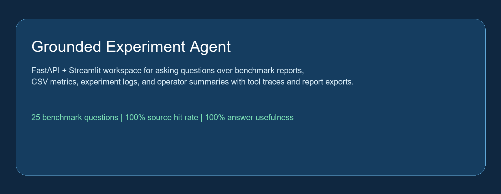
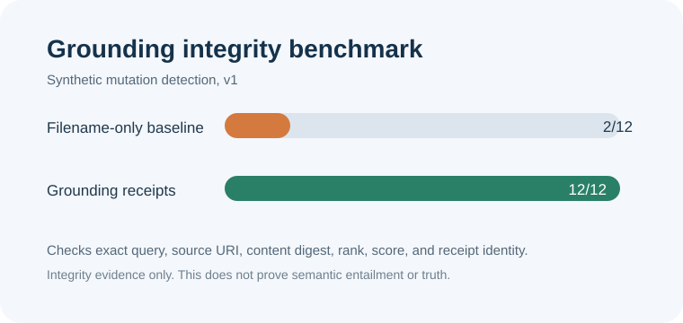
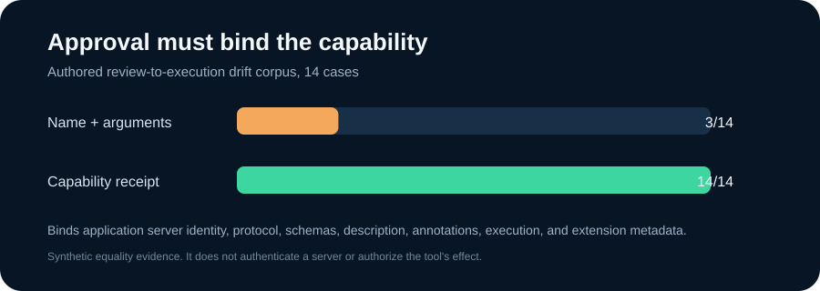
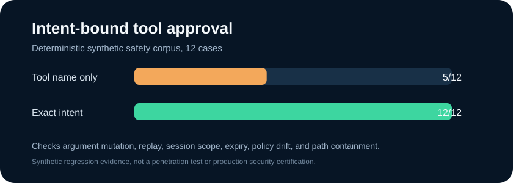
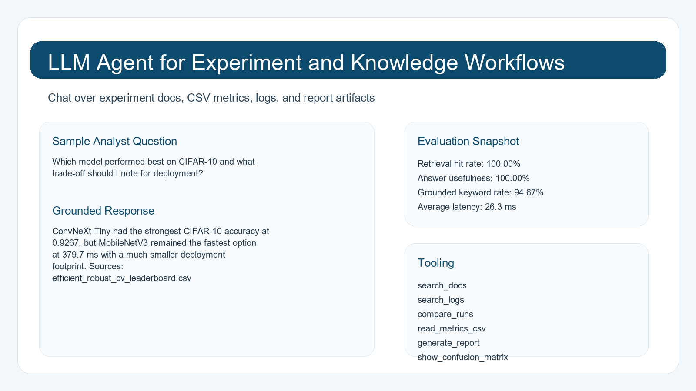
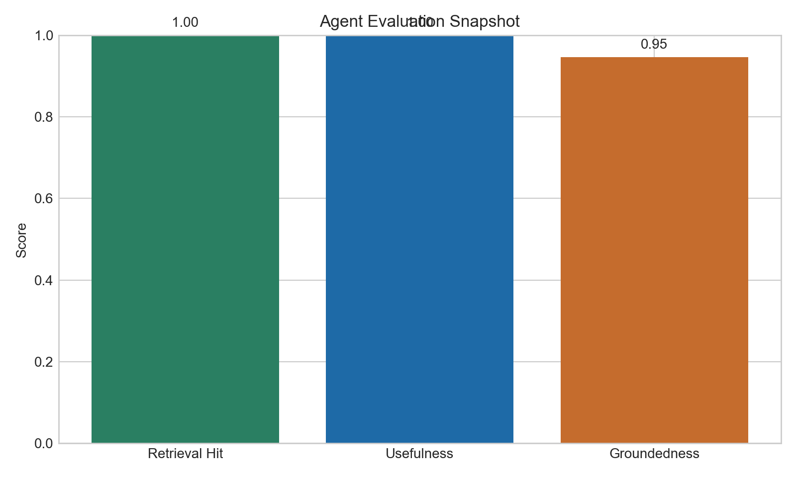
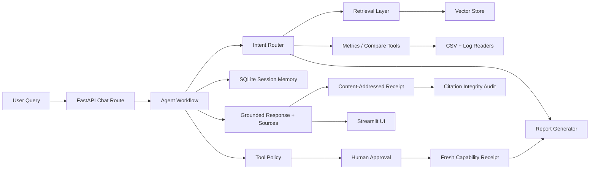

# LLM Agent for Experiment and Knowledge Workflows

[](https://github.com/Ikteder/llm-agent-workflows/actions/workflows/ci.yml)










An agent workspace for researchers and engineers who want more than a chatbot. This project answers questions over experiment reports, CSV metrics, and logs; compares runs across projects; generates grounded reports; keeps session memory in SQLite; and returns cited source chunks with every answer. Each sourced response includes a content-addressed grounding receipt that binds the query, exact chunk digests, retrieval order, scores, and citation tokens. Report writes pause behind an exact-intent, single-use approval boundary. External MCP-shaped tools can also bind that approval to the reviewed server identity and advertised capability, then fail closed if a fresh observation drifts before execution.

The corpus is built from real outputs generated in other showcase repos:

- predictive maintenance with early warning and drift detection
- model export and inference benchmarking
- efficient and robust computer vision benchmarking

## Why This Project Stands Out

- It looks like internal ML tooling, not a single notebook.
- It combines backend APIs, retrieval, tool use, memory, evaluation, and reporting.
- It is grounded in real experiment artifacts instead of toy text files.
- It ships with an evaluation harness and benchmark question set, not just a demo.
- Its write tool is governed by a visible policy, exact server-held arguments, project scope, expiry, one-time consumption, and an audit trail.
- Its external-tool approval option binds the reviewed capability without copying raw schemas or descriptions into audit logs.
- Its citations resolve to exact content digests instead of relying on filenames alone.

## What It Does

- `search_docs`: retrieve grounded chunks from Markdown reports and READMEs
- `search_logs`: search JSON and log files for run events
- `compare_runs`: compare metrics across CSV outputs and rank results
- `read_metrics_csv`: preview and inspect metric tables
- `show_confusion_matrix`: surface artifact paths for relevant confusion matrices
- `summarize_failures`: extract failure-pattern summaries from benchmark docs
- `generate_report`: write Markdown and HTML only after exact-intent approval

## Grounding Receipts

Every sourced API response includes:

- canonical repository-relative source URIs;
- stable chunk and content SHA-256 digests;
- ordered citation tokens such as `[S1]` and `[S2]`;
- a versioned receipt ID over the normalized query and ordered evidence;
- a citation-integrity audit that detects missing or unknown answer tokens.

The offline verifier can compare a saved receipt with newly retrieved chunks and identify missing evidence, content mutation, URI substitution, rank changes, score changes, unexpected chunks, and query changes. The receipt is deterministic and unsigned. It proves evidence identity and order, not who produced the receipt.

Citation integrity is not semantic faithfulness. A valid receipt does not prove that arbitrary generated prose is entailed by a source, that the source is true, or that the retrieval set is complete. Those broader questions still require task-specific evaluation and, where appropriate, human review or carefully validated semantic judges.

## Tool Policy and Approval Flow

Read tools remain available without interruption. The report tool is different because it creates files.

1. The agent validates the project scope and plans the report with complete source bindings.
2. The server stores the exact tool name, arguments, session, project, policy version, expiry, and keyed digest.
3. The API or Streamlit interface shows the pending call and accepts an explicit approve or reject decision.
4. A resumed request names that approval ID. The server executes the stored invocation, not a newly generated replacement.
5. Approval is consumed before the write. Replays, expired requests, different sessions, unknown projects, stale policies, and escaped paths fail closed.

This is local application approval, not user authentication or multi-tenant authorization. Put the API behind appropriate identity and transport controls before a network deployment.

## MCP Capability-Bound Approval

MCP permits tool catalogs to change over time. A durable approval that remembers only `tool_name` and arguments can therefore resume against a different server or changed tool definition. The optional `ToolCapability` contract records:

- an application-assigned server ID, transport, and MCP protocol version;
- the tool name, title, description, input and output schemas;
- annotations, execution metadata, `_meta`, and unknown public contract fields;
- content-minimized section and aggregate SHA-256 digests.

When an approved external call resumes, `consume()` requires a fresh observation. Missing or changed evidence denies execution without consuming the approval. Canonical JSON ignores object-key order, but preserves values and array order. Server-provided annotations remain advisory, and the application-assigned server ID must come from trusted configuration.

Use the application-owned policy from Python:

```python
from pathlib import Path

from app.agent.capability_receipts import ToolCapability
from app.agent.tool_policy import ToolInvocation, ToolPolicyEngine

# Load server identity and the secret from trusted application configuration.
def review_call(secret: bytes, listed_tool: dict):
    policy = ToolPolicyEngine(
        secret=secret,
        audit_path=Path("artifacts/generated/capability-audit.jsonl"),
        allowed_projects={"research"},
    )
    reviewed = ToolCapability(
        server_id="configured-report-server",
        transport="streamable-http",
        protocol_version="2026-07-28",
        tool=listed_tool,
    )
    pending = policy.authorize(ToolInvocation(
        session_id="review-session",
        tool_name="generate_report",  # Application policy key; may differ from MCP name.
        arguments={"title": "Reviewed report"},
        project="research",
        capability=reviewed,
    ))
    return policy, pending.approval_request
```

Present the application's trusted review UI with the actual tool definition and arguments. After explicit approval, call `policy.decide(approval_id, session_id="review-session", approve=True)`. Re-list the tool through the same authenticated connection and construct a fresh `ToolCapability`. Call `policy.consume(..., observed_capability=fresh)` with the approval ID and the same session, application tool name, and project. Dispatch only when `decision.status == "allowed"`, using `decision.arguments`. The adapter must map the application policy key to the reviewed MCP tool and retain the checked connection through dispatch. The included web report tool uses the local path; an external MCP transport adapter is not included.

This receipt proves equality between two observations. It does not authenticate the server, authorize the user, decide whether a tool is safe, or prove that the implementation follows its advertised schema.

## Showcase Screens





## Evaluation Snapshot

The benchmark harness runs 25 grounded questions over the real corpus in [benchmark_questions.json](artifacts/benchmark_questions.json). Latest generated metrics from [eval_summary.json](artifacts/generated/eval_summary.json):

- Retrieval hit rate: `100%`
- Answer usefulness: `100%`
- Grounded keyword rate: `90.67%`
- Average latency: `22.68 ms`
- Hallucination proxy: `0%`

The new `tool-policy-safety-v1` corpus contains twelve deterministic cases.

| Evaluator | Correct cases | Accuracy |
|---|---:|---:|
| Tool-name-only approval baseline | 5 / 12 | 41.67% |
| Exact-intent policy | 12 / 12 | 100% |

The corpus targets implemented controls and is not an independent penetration test or production security certification.

The `grounding-integrity-v1` corpus contains twelve deterministic evidence mutations.

| Evaluator | Correct cases | Accuracy |
|---|---:|---:|
| Filename-only baseline | 2 / 12 | 16.67% |
| Content-addressed grounding receipt | 12 / 12 | 100% |

The receipt corpus is synthetic and implementation-aligned. It tests exact evidence identity and order, not semantic entailment, general RAG quality, or production adoption.

The `mcp-capability-drift-v1` corpus contains fourteen deterministic review-to-execution cases.

| Evaluator | Correct cases | Accuracy |
|---|---:|---:|
| Name-and-arguments baseline | 3 / 14 | 21.43% |
| Capability-bound approval | 14 / 14 | 100% |

The corpus includes two safe controls and isolated changes to server identity, transport, protocol, name, descriptions, schemas, annotations, execution metadata, `_meta`, and an unknown contract field. This is authored regression evidence, not a penetration test or production false-positive estimate.

Full outputs:

- [Evaluation summary](artifacts/generated/evaluation_summary.md)
- [Evaluation results JSON](artifacts/generated/eval_results.json)
- [Sample generated report](artifacts/generated/sample_cross_project_report.md)
- [Sample generated report (HTML)](artifacts/generated/sample_cross_project_report.html)

## Demo Questions

- `Which model performed best on this dataset?`
- `Compare the last ResNet and MobileNetV3 runs.`
- `Which predictive maintenance method had the best F1 score?`
- `Did the ONNX export for ResNet18 pass verification?`
- `Summarize the failure cases from the computer vision benchmark.`
- `Generate a short experiment report from the latest benchmark and maintenance results.`

## Architecture



## Repository Layout

```text
llm-agent-workflows/
├── app/
│   ├── api/
│   ├── agent/
│   ├── models/
│   ├── retrieval/
│   └── services/
├── data/
│   ├── docs/
│   ├── logs/
│   ├── csv/
│   ├── reports/
│   └── artifacts/
├── frontend/
│   └── streamlit_app.py
├── artifacts/
│   ├── benchmark_questions.json
│   └── generated/
├── scripts/
├── tests/
└── README.md
```

## Implementation Notes

- Default retrieval uses `TF-IDF` embeddings so the demo works locally without downloading a large embedding model.
- The code also supports `sentence-transformers`; set `EMBEDDING_BACKEND=sentence-transformer` to switch.
- Default answer generation uses a deterministic grounded summarizer for reproducibility.
- If `OPENAI_API_KEY` is set and `LLM_BACKEND=openai`, the agent can upgrade the final answer generation step with the OpenAI API.
- Session history is stored in SQLite so the chat retains short-term memory across turns.

## Run Locally

1. Create the environment and install dependencies.

```bash
python -m venv .venv_run
.venv_run\Scripts\python -m pip install -r requirements.txt
.venv_run\Scripts\python -m pip install -e . --no-deps
```

2. Start the API.

```bash
.venv_run\Scripts\python -m uvicorn app.main:app --reload
```

3. Start the Streamlit frontend in a second terminal.

```bash
.venv_run\Scripts\python -m streamlit run frontend/streamlit_app.py
```

4. Rebuild the demo assets and evaluation bundle when needed.

```bash
.venv_run\Scripts\python scripts/build_demo_assets.py
.venv_run\Scripts\python -m scripts.evaluate_tool_policy --json artifacts/generated/tool-policy-benchmark.json --svg docs/graphics/tool-policy-benchmark.svg
.venv_run\Scripts\python -m scripts.evaluate_grounding_integrity --json docs/experiments/grounding-integrity-v1-results.json --svg docs/graphics/grounding-integrity-v1.svg
.venv_run\Scripts\python -m scripts.evaluate_capability_receipts --json docs/experiments/mcp-capability-drift-v1-results.json --svg docs/graphics/mcp-capability-drift-v1.svg
```

## Approval API Example

First request a report. The API returns `approval_required` and does not create a file.

```bash
curl -X POST http://127.0.0.1:8000/api/chat \
  -H "Content-Type: application/json" \
  -d '{"session_id":"demo","project":"predictive_maintenance","question":"Generate a maintenance report","generate_report":true}'
```

Approve the returned ID, then repeat the original request with `approval_id`. The Streamlit interface performs this resume flow through explicit buttons.

## API Example

```bash
curl -X POST http://127.0.0.1:8000/api/chat ^
  -H "Content-Type: application/json" ^
  -d "{\"session_id\":\"demo\",\"project\":\"efficient_robust_cv\",\"question\":\"Which model performed best on CIFAR-10?\",\"generate_report\":false}"
```

## Testing

```bash
.venv_run\Scripts\python -m pytest -q
```

Current deterministic validation:

- `pytest`: `42 passed`
- `uvicorn --help`: passed
- demo asset build: passed
- evaluation benchmark: `25 / 25` grounded benchmark questions correct
- tool policy corpus: exact intent `12 / 12`; tool-name baseline `5 / 12`
- grounding integrity corpus: receipts `12 / 12`; filename-only baseline `2 / 12`
- MCP capability drift corpus: receipts `14 / 14`; name-and-arguments baseline `3 / 14`

## Best Files To Open First

- [FastAPI app entrypoint](app/main.py)
- [Agent workflow](app/agent/graph.py)
- [Tool implementations](app/agent/tools.py)
- [Capability receipts](app/agent/capability_receipts.py)
- [Retrieval ingestion](app/retrieval/ingest.py)
- [Evaluation builder](scripts/build_demo_assets.py)
- [Benchmark set](artifacts/benchmark_questions.json)

## Honest Note

This repo is intentionally optimized for reproducibility and grounded outputs. The default demo path favors deterministic retrieval and tool-based summarization over a fully autonomous long-horizon agent loop, which keeps the benchmark stable and makes the evaluation results meaningful.

The tool policy is provider-neutral application code. It was influenced by current approval and tool-safety guidance from OpenAI Agents SDK, Pydantic AI, LangChain and LangGraph, and the Model Context Protocol specification. No upstream code was copied. See the [dated reference review](docs/notes/2026-10-01-tool-policy-reference-review.md).

The grounding receipt is also provider-neutral application code. Ragas, DeepEval, TruLens, Applied ML, and the original Google production-data paper informed the comparison and problem framing. No upstream code or prompts were copied. See the [grounding reference review](docs/notes/2026-10-08-grounding-receipts-reference-review.md).

The MCP capability receipt is an independently designed application contract. The MCP specification, OpenAI Agents SDK, Pydantic AI, LangChain, Applied ML, and the original Amazon data-quality work informed the comparison and requirements. No upstream source, fixtures, benchmarks, or prompts were copied. See the [MCP capability reference review](docs/notes/2026-10-23-mcp-capability-reference-review.md).

## Limitations

- The checked-in benchmark is a compact deterministic evaluation over bundled artifacts, not evidence of general agent reliability.
- Retrieval quality depends on document formatting and the included TF-IDF representation.
- Grounding receipts are unsigned local integrity records. They do not provide authenticity, authorization, non-repudiation, semantic entailment, source truth, or retrieval completeness.
- The twelve-case grounding corpus is synthetic and implementation-aligned. It does not measure general citation quality or adversarial robustness.
- The default path does not evaluate adversarial instructions, multi-user isolation, long-running orchestration, or production access controls.
- External-model behavior and cost are not covered by the offline test suite.
- The approval endpoint does not authenticate a person. A public or shared deployment still needs authentication, authorization, CSRF protection where applicable, and transport security.
- Pending approvals are in process memory and fail closed across restart; the JSONL log is evidence, not resumable authority.
- Version 0.4 gates one local filesystem write tool and provides an optional external capability-binding contract. It does not implement or sandbox arbitrary code, networks, shell tools, or MCP transports.
- The twelve-case policy corpus is synthetic, implementation-aligned regression evidence.
- Capability receipts prove equality of bounded observations, not server authentication, tool honesty, effect authorization, or safety. Benign definition changes can require reapproval.
- A trusted adapter must obtain a fresh observation and keep the checked server connection bound to dispatch. Equality checks alone cannot prevent a remote implementation changing after observation; stronger guarantees require a server-enforced version precondition.
- The installed wheel contains library code; run the full application demo from the checkout or supply its data directory explicitly.
- The fourteen-case capability corpus is synthetic and implementation-aligned; it has not been tested against independently captured framework catalogs.

## Best Next Improvement

Add adapters for independently captured OpenAI Agents, Pydantic AI, and LangChain MCP tool catalogs, then test list-change, cache invalidation, reconnect, and multi-server name-collision behavior without adding a paid-model requirement.

## Project Records

- [Approved tool policy spec](docs/superpowers/specs/2026-10-01-intent-bound-tool-policy.md)
- [Reference comparison and impact gate](docs/notes/2026-10-01-tool-policy-reference-review.md)
- [Exact-intent decision record](docs/decisions/2026-10-01-server-held-exact-intent-approvals.md)
- [Policy corpus dataset card](docs/datasets/tool-policy-safety-v1.md)
- [Model and provider card](docs/models/2026-10-01-model-provider-card.md)
- [Verification record](docs/experiments/2026-10-01-tool-policy-verification.md)
- [Approved grounding receipt spec](docs/superpowers/specs/2026-10-08-content-addressed-grounding-receipts.md)
- [Grounding reference comparison](docs/notes/2026-10-08-grounding-receipts-reference-review.md)
- [Grounding integrity corpus card](docs/datasets/grounding-integrity-v1.md)
- [Grounding receipt decision](docs/decisions/2026-10-08-content-addressed-grounding-receipts.md)
- [Grounding model boundary](docs/models/2026-10-08-grounding-receipt-model-card.md)
- [Grounding verification record](docs/experiments/2026-10-08-grounding-receipts-verification.md)
- [Approved MCP capability spec](docs/superpowers/specs/2026-10-23-mcp-capability-receipts.md)
- [MCP capability reference comparison](docs/notes/2026-10-23-mcp-capability-reference-review.md)
- [MCP capability decision](docs/decisions/2026-10-23-bind-reviewed-mcp-capability.md)
- [MCP capability corpus card](docs/datasets/mcp-capability-drift-v1.md)
- [Capability receipt model boundary](docs/models/2026-10-23-capability-receipt-model-card.md)
- [MCP capability verification record](docs/experiments/2026-10-23-mcp-capability-receipts-verification.md)

## License

Released under the [MIT License](LICENSE).
